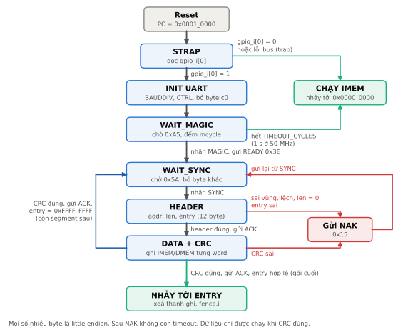
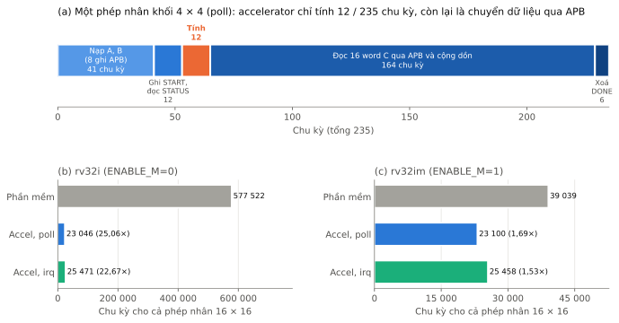
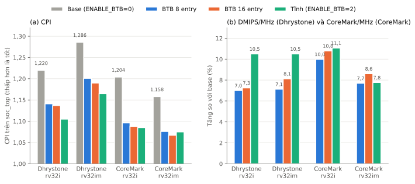

# Chương X. Core RV32I (`rv32_core`)

**Bản nháp.** Mọi con số có ghi file nguồn trong repo. Ô ghi [CHỜ GENUS] là số chính thức phải lấy từ Genus và Innovus ở trường (STA-04).

Quy ước dẫn nguồn:

- "Dx" là quyết định trong `docs/core_decisions.md`.
- "mục x.y" là mục trong `docs/spec/core.md`.
- D-041 và `docs/btb_eval.md` hiện nằm trên nhánh `feat/nhan-btb` (chưa merge, chờ review 8/11). Mục X.8 dẫn số từ đó.

## X.1 Mục tiêu và ISA

Mục tiêu:

- Core đúng chuẩn RISC-V, có bằng chứng tuân thủ chính thức (riscv-arch-test so với Spike).
- CPI thấp ở tần số đề bài yêu cầu (50 MHz, chu kỳ 20 ns trong SDC).
- Đi được tới GDS bằng flow Cadence của môn. RTL Verilog-2005, không latch, reset bất đồng bộ `rst_n` tích cực mức thấp.
- Hỗ trợ đo công suất lúc chờ ngắt (WFI ngủ thật để Genus gate clock).

ISA (mục 4.1, 4.7):

- RV32I, Zicsr, Zicntr, Zifencei. Chỉ machine mode.
- RV32M khi tham số `ENABLE_M=1`.
- FENCE là NOP. WFI cho core ngủ khi `ENABLE_WFI_SLEEP=1`, là NOP khi bằng 0.
- Load, store và nhảy lệch địa chỉ gây ngoại lệ, không xử lý bằng phần cứng.
- CSR M-mode: mstatus, misa, mie, mip, mtvec (direct), mepc, mcause, mtval, mscratch, mcycle(h), minstret(h), các bí danh chỉ đọc cycle, time, instret và nhóm ID.

Cổng của core (mục 4.10): cổng lấy lệnh `if_*` (đọc đồng bộ từ IMEM hoặc boot ROM), bus dữ liệu valid/ready `d_req_*`, `d_rsp_*`, 3 đường ngắt mức, `mtime_i[63:0]`, `core_sleep_o`. Tham số `ENABLE_M`, `ENABLE_WFI_SLEEP`, `RESET_PC` (mặc định 0x0001_0000, boot ROM). Nhánh `feat/nhan-btb` thêm `ENABLE_BTB` và `BTB_ENTRIES` (mục X.8).

## X.2 Vi kiến trúc 3 tầng


*Hình X.1. Vi kiến trúc `rv32_core`. Hình sinh từ `docs/figures/core_microarch.py` (D-034).*

| Tầng | Việc chính |
| --- | --- |
| IF | `if_pc_q` là flop, đưa thẳng ra chân địa chỉ IMEM. Chọn PC kế tiếp |
| EX | Nhận lệnh thẳng từ ngõ ra IMEM. Giải mã, đọc regfile, forward, ALU, so sánh nhánh, tính địa chỉ và kiểm tra lệch, phát yêu cầu bus dữ liệu, M-unit |
| WB | Nhận dữ liệu đọc, căn chỉnh và mở rộng dấu, ghi regfile, thực thi CSR, xử lý trap, MRET, FENCE.I, WFI |

Nguồn: mục 4.2.

Các điểm chính:

- **Không có thanh ghi lệnh IF/EX.** SRAM đọc đồng bộ nên chính ngõ ra IMEM đóng vai trò thanh ghi tầng. Khi dừng, lệnh được chốt vào `ex_instr_hold_q` (mục 4.3, D-014).
- **Forward WB → EX** cho mọi kết quả ghi rd, gồm cả dữ liệu load lấy thẳng từ bus sau căn chỉnh. Không có stall load-use (mục 4.5).
- **Chuyển hướng:** nhánh, JAL, JALR quyết định ở EX, phạt 1 chu kỳ. Trap, MRET, FENCE.I, WFI chuyển hướng từ WB, phạt 2 chu kỳ (mục 4.4, D-023).
- **Dừng:** `pipe_stall = wb_wait | ex_wait`, giữ IF và EX khi bus chậm hoặc M-unit chưa xong (D-014).
- **RV32M:** nhân 2 chu kỳ (EX dừng 1), chia restoring 1 bit mỗi chu kỳ (EX dừng 33) (mục 4.9, D-031).

## X.3 Các quyết định chính

Chọn 10 quyết định ảnh hưởng nhiều nhất tới CPI, timing và tính đúng. Danh sách đầy đủ ở `docs/core_decisions.md`.

| # | Quyết định | Lý do | Phương án đã loại |
| --- | --- | --- | --- |
| 1 | **3 tầng, không có thanh ghi IF/EX** (D-014, mục 4.3) | Tận dụng SRAM đọc đồng bộ làm thanh ghi tầng. Phạt nhánh chỉ 1 chu kỳ. Địa chỉ IMEM ra từ flop nên đường địa chỉ ngắn | Thêm tầng IF/EX (thêm 1 chu kỳ phạt nhánh). Phát lại PC khi dừng (địa chỉ IMEM đi tổ hợp từ `ready`) |
| 2 | **Forward dữ liệu load thẳng từ bus, không stall load-use** (mục 4.5, D-014) | CPI thấp hơn. 50 MHz cho đủ thời gian đi qua căn chỉnh load và mux forward | Stall 1 chu kỳ sau load |
| 3 | **ALU dùng chung cho địa chỉ và đích nhảy, bộ so sánh nhánh riêng** (D-007) | Tiết kiệm một bộ cộng. So sánh chạy song song với cộng đích, không nối tiếp | Dùng ALU SUB để so sánh rồi thêm bộ cộng đích (zero-detect kéo dài đường găng) |
| 4 | **Regfile bằng flop, enable riêng từng thanh ghi, không bypass bên trong** (D-011) | Reset xác định cho GLS. Genus gate clock theo nhóm. Bypass đã có ở mạng forward | Regfile bằng SRAM hoặc latch (cần macro, không reset được) |
| 5 | **Bus valid/ready, `d_req_valid_o` không phụ thuộc `ready`** (D-015, mục 5.1) | Đúng luật 5 của bus. Cho phát yêu cầu mới ngay chu kỳ nhận phản hồi nên load liên tiếp mỗi chu kỳ | Bus kiểu req/gnt có `valid` phụ thuộc `gnt` |
| 6 | **Ngoại lệ gắn cờ ở EX, xử lý ở WB, kiểm tra CSR ở EX** (D-016, D-021) | Một đường ngoại lệ chung. WB không thêm nguồn trap nên `d_req_valid_o` không phụ thuộc giải mã CSR | Kiểm tra CSR ở WB (kéo dài `wb_redirect` → `d_req_valid_o`) |
| 7 | **Ngoại lệ chính xác: chuyển hướng từ WB chặn tổ hợp yêu cầu bus của EX** (D-023, mục 4.8) | Lệnh sau lệnh trap không ghi bộ nhớ. Không vi phạm luật bus 1 vì lúc đó EX chưa có yêu cầu đang chờ | Cho lệnh sau trap chạy rồi khôi phục (không làm được với store) |
| 8 | **Ngắt nhận ở EX, forward MIE và mie từ WB, không ngắt yêu cầu đang wait state** (D-024, D-038) | Bật hoặc tắt ngắt có hiệu lực đúng từ lệnh kế tiếp. Giữ luật bus 1 | Chốt quyết định ngắt vào flop (chậm 1 chu kỳ). Nhận ngắt ở WB (mất chính xác với store). Chặn ngắt khi WB ghi mstatus (bản đầu, gây lỗi ở mục X.4) |
| 9 | **WFI ngủ thật bằng cách tắt enable** (D-025, mục 4.11) | `if_req_o = 0` từ flop, mọi flop pipeline giữ nguyên để Genus gate clock. Phục vụ phần so sánh công suất polling và WFI | WFI là NOP (vẫn hỗ trợ khi `ENABLE_WFI_SLEEP=0`) |
| 10 | **Nhân 2 chu kỳ bằng thanh ghi trung gian, chia 1 bit mỗi chu kỳ** (D-031) | Mỗi chu kỳ chỉ có nửa bộ nhân, không cần multicycle path trong SDC. Chia đơn giản, đủ cho 50 MHz | Nhân 33 × 33 một chu kỳ (cần multicycle path). Chia radix-4 (tốn bảng chọn thương) |

Hai quyết định nhỏ hơn nhưng đáng nêu trong báo cáo:

- **D-035:** mtval của EBREAK = PC, để khớp Spike trong riscv-arch-test (`docs/riscof.md`).
- **D-037:** nửa cao của `mcycle` và `minstret` có enable riêng, khoảng 58 flop ít nhận clock hơn mỗi chu kỳ (ước lượng tay, `docs/timing_core.md`).
- **D-038:** forward MIE và mie cho kiểm tra ngắt, thay cho luật chặn ngắt của quyết định 8. Xem mục X.4.

## X.4 Ngắt và WFI

### Luật nhận ngắt

Core có 3 đường ngắt mức: MEI (từ bộ điều khiển ngắt IRQC, gom UART, GPIO, accelerator), MTI (`mtime >= mtimecmp` của Timer), MSI (bit MSIP của Timer) (`rtl/bus/soc_top.v`). Ngắt được nhận ở EX, không chờ tới WB (mục 4.8, D-024).

- **Điều kiện:** `mstatus.MIE = 1` và `(mip & mie) != 0`. Ưu tiên MEI > MSI > MTI. Mã ngắt được chốt khi lệnh rời EX, vì đường ngắt có thể hạ trước khi lệnh tới WB.
- **Lệnh bị ngắt:** lệnh hợp lệ ở EX được đánh dấu "bị ngắt". Nó không thực thi, không phát yêu cầu bus. Tới WB thì nhận trap với mepc = PC của chính nó, nên sau MRET lệnh này chạy lại từ đầu.
- **Không nhận ngắt** khi WB đang chuyển hướng (lệnh ở EX sẽ bị huỷ), và khi lệnh ở EX có yêu cầu bus đang chờ `ready`. Luật bus 1 bắt master giữ nguyên yêu cầu đã hiện ra, nên lệnh đó phải hoàn thành trước (`ex_req_wait_q`, D-024).
- **Phép chia đang chạy vẫn bị ngắt** và chạy lại sau MRET. Nhờ vậy độ trễ ngắt không cộng thêm 33 chu kỳ (D-032).
- **Bật và tắt ngắt có hiệu lực ngay lệnh kế tiếp.** Khi WB đang ghi mstatus hoặc mie, EX dùng 4 bit MIE, MSIE, MTIE, MEIE sau lần ghi đó (forward từ WB, D-038). Sau `csrci mstatus, MIE` lệnh kế không bị ngắt. Sau `csrsi mstatus, MIE` lệnh kế bị ngắt nếu có ngắt chờ.

### Forward MIE (D-038) và câu chuyện `accel_bench`

Bản đầu (D-024) không forward mà chặn hẳn ngắt khi WB đang ghi mstatus hoặc mie (`wb_irq_block`). Tắt ngắt vì vậy vẫn đúng ngay lệnh kế. Bật ngắt thì chậm một lệnh. Đặc tả Privileged cho phép nhận ngắt trễ, và các test `irq`, `wfi` đều PASS.

Lỗi chỉ lộ ra khi chạy benchmark accelerator dùng ngắt (`fw/bench/accel_bench.c`, EVA-01). Firmware chờ ngắt bằng vòng không race, mẫu chuẩn của phần mềm nhúng:

```text
loop: csrc mstatus, MIE     # tắt ngắt
      kiểm irq_done         # handler đặt cờ
      wfi                   # ngủ, thức khi có ngắt chờ dù MIE = 0
      csrs mstatus, MIE     # bật ngắt, ngắt phải được nhận ở đây
      j loop
```

Vòng này không bao giờ vào được handler. Lệnh ngay sau `csrs mstatus` là `csrc mstatus` của vòng sau, và lệnh đó không ngắt được vì `wb_irq_block`. Vậy MIE chỉ bằng 1 trong đúng một lệnh không ngắt được. Handler không bao giờ chạy, `irq_done` không bao giờ bằng 1, nên bản `irq` của benchmark treo trong vòng chờ. Bản `poll` không dùng ngắt nên vẫn chạy đúng.

Cách xử lý:

- Bước đầu né lỗi bằng một `nop` sau `csrs mstatus` trong `accel_bench.c`. Cách này dễ quên và phần mềm chuẩn không làm (ví dụ `local_irq_enable` rồi tắt ngay của hệ điều hành).
- Sửa RTL (D-038): bỏ `wb_irq_block`. `rv32_csr` tính 4 bit bật ngắt sau lần ghi từ `wb_result_q` và mã lệnh ở WB, chỉ đi từ flop, không qua mux `rdata_o`. Lệnh CSR đã ở WB thì chắc chắn hoàn thành (lệnh CSR lỗi bị gắn cờ từ EX), nên dùng trước giá trị mới là an toàn.
- Viết test `fw/tests/asm/wfi_pending.S` tái hiện lỗi. Test FAIL trên RTL cũ (W1 ngủ thừa 1 chu kỳ ở test 2, W0 và W1 sai mepc ở test 8) và PASS sau khi sửa. Bỏ `nop` né lỗi trong `accel_bench.c`.
- Chi phí timing (flow nhà): ENABLE_M=0 2,856 ns (trước 2,855), ENABLE_M=1 3,113 ns (trước 3,007, +3,5%, sát mức nhiễu ±3% của abc). Đường găng ENABLE_M=1 vẫn ở bộ nhân, không đi qua logic forward (D-038).

Bài học: test đơn vị và test assembly chỉ kiểm điều người viết nghĩ tới. Chạy một chương trình thật dùng ngắt theo mẫu chuẩn mới lộ ra khoảng trống này.

### WFI (`ENABLE_WFI_SLEEP=1`)

- WFI xử lý ở WB như lệnh tuần tự hoá: huỷ lệnh ở EX, PC kế = PC(WFI)+4, đặt `sleep_q` (mục 4.11, D-025).
- Khi ngủ: `if_req_o = 0` từ flop `sleep_q`, mọi flop pipeline, regfile và M-unit giữ nguyên nhờ tắt enable, để Genus gate clock. `mcycle` và `mtime` vẫn chạy. `core_sleep_o` báo cho SoC.
- **Thức khi `(mip & mie) != 0`**, không xét mstatus.MIE, đúng đặc tả. MIE=1 thì ngắt được nhận ở lệnh kế với mepc = PC(WFI)+4. MIE=0 thì chạy tiếp lệnh sau WFI. Vòng chờ ở trên dùng đúng trường hợp MIE=0 này.
- **Ngắt đã chờ sẵn thì không ngủ** (D-038). Nếu `(mip & mie) != 0` lúc WFI ở WB thì WFI chỉ chuyển hướng tới PC+4, 0 chu kỳ ngủ. Nếu MIE=1 và ngắt đã chờ khi WFI còn ở EX thì chính WFI bị ngắt, mepc = PC(WFI).
- `ENABLE_WFI_SLEEP=0`: WFI là NOP. Cả hai cấu hình chạy cùng bộ test `wfi`, `wfi_pending`, `irq`.
- Số liệu (test `wfi`, nominal): với W1 core ngủ 801 trên 1003 chu kỳ và chỉ chạy 177 lệnh. Với W0 cùng test chạy 625 lệnh trong 954 chu kỳ (`docs/riscv-tests-status.md`). Công suất polling so với WFI: [CHỜ GENUS].

## X.5 Bootloader UART (D-039, D-040)

Boot ROM 1 KB (256 word) ở 0x0001_0000 là reset vector của core. Bootloader trong ROM nhận chương trình qua UART, ghi từng segment vào IMEM hoặc DMEM qua cổng dữ liệu rồi nhảy tới entry. Không cần sửa `soc_top`, vì IMEM ghi được từ cổng dữ liệu (`docs/boot.md`).



*Hình X.2. Sơ đồ trạng thái bootloader trong `fw/boot/boot.S`. Hình sinh từ `docs/figures/boot_fsm.py`.*

### Chân strap `gpio_i[0]`

| `gpio_i[0]` | Hành vi |
| --- | --- |
| 0 | Nhảy ngay về 0x0000_0000, không đụng UART, giống boot ROM bản base |
| 1 | Boot qua UART: chờ MAGIC tối đa `TIMEOUT_CYCLES` (1 s ở 50 MHz), hết giờ thì nhảy về 0x0000_0000 |

- Cực tính 0 = chạy IMEM là bắt buộc. `tb_soc` có `PAD_IN[0] = 0` nên mọi test cũ chạy thẳng IMEM, chỉ thêm khoảng 35 chu kỳ. Bản build không có GPIO (`tb_core_bus`) đọc GPIO bị lỗi bus, trap về nhánh nhảy IMEM vì `mtvec` trỏ sẵn về đó (D-039).
- Cách làm giống chân BOOT0 của nhiều vi điều khiển. Silicon có cửa sổ chờ đủ dài cho người nhấn reset, còn mô phỏng không chậm đi.

### Giao thức

Mọi số nhiều byte là little endian, UART 8N1.

| Bước | Hướng | Nội dung |
| --- | --- | --- |
| 1 | PC → chip | MAGIC `0xA5`, lặp cách nhau khoảng 2 ms tới khi có READY |
| 2 | chip → PC | READY `0x3E` |
| 3 | PC → chip | SYNC `0x5A`, rồi header 12 byte: addr, len, entry |
| 4 | chip → PC | ACK `0x06` hoặc NAK `0x15` cho header |
| 5 | PC → chip | data (len byte), rồi CRC-32 (như `zlib.crc32`) của addr, len, entry và data |
| 6 | chip → PC | ACK hoặc NAK cho CRC |

- Mỗi segment là một gói từ SYNC tới CRC. `entry = 0xFFFF_FFFF` nghĩa là còn gói sau. Gói cuối mang địa chỉ nhảy thật (D-040).
- `scripts/uart_pack.py` đọc ELF và gửi mỗi section có nội dung (`.text`, `.rodata`, `.data`) thành một gói đúng địa chỉ chạy, gói cuối mang entry của ELF. `.bss` không gửi vì crt0 tự xoá.
- Header hợp lệ khi addr và len chia hết cho 4, len > 0, đoạn [addr, addr + len) nằm trọn trong IMEM hoặc trọn trong DMEM (lấy từ `rtl/bus/soc_map.vh`), entry là `0xFFFF_FFFF` hoặc chia hết cho 4 và nằm trong IMEM.
- Sau ACK của gói cuối, bootloader chờ ACK ra hết đường truyền, xoá `mtvec` và các thanh ghi đã dùng, chạy `fence.i` rồi nhảy.

### Xử lý lỗi

- **Header sai** (ngoài vùng, vượt cuối vùng, lệch, entry sai): NAK ngay sau header, bộ nhớ không bị ghi. PC không phải gửi cả gói vô ích.
- **CRC sai:** NAK sau dữ liệu. Dữ liệu đã được ghi vào bộ nhớ trong lúc nhận, nhưng gói lỗi không bao giờ được chạy. PC gửi lại cả gói từ SYNC.
- Sau NAK bootloader quay về chờ SYNC và không còn timeout.
- Byte rác trước MAGIC hoặc trước SYNC bị bỏ qua. MAGIC lặp có khoảng nghỉ để bộ thu UART đồng bộ lại nếu reset nhả giữa một byte.

### Kích thước và thời gian nạp

- Assembly thuần, chỉ dùng thanh ghi, không stack, không dùng DMEM. Cổng dữ liệu không đọc được ROM nên mọi hằng số nạp bằng `li`.
- ROM: **143 / 256 word** (572 byte, 56%). `scripts/gen_boot_rom.py` báo lỗi nếu vượt 256 word.
- CRC-32 tính từng bit, chỉ tốn 9 lệnh. Mỗi byte xử lý trong khoảng 100 chu kỳ, nhỏ hơn nhiều so với 4 320 chu kỳ của một byte ở 115200 baud và 50 MHz.

Ở 115200 baud mỗi byte mất 86,8 µs. Mỗi gói thêm 17 byte (SYNC, header, CRC), cả luồng thêm 1 byte MAGIC (`docs/boot.md` mục 6).

| Chương trình | Byte truyền | Thời gian |
| --- | ---: | ---: |
| `hello.S` (24 word), đo trong test `rtl_load` | 113 (SYNC tới ACK) | 496 232 chu kỳ = 9,9 ms ở 50 MHz |
| `cprog.c` (4 segment, 380 byte dữ liệu) | 449 | 39 ms |
| Đầy IMEM 16 KB | 16 402 | 1,42 s |

### Kiểm chứng

`make sim-boot` chạy 7 test trên `soc_top` thật, đều PASS: nạp `hello`, nạp chương trình C 4 segment (`celf`: biến toàn cục khởi tạo khác 0, mảng hằng, chuỗi hằng, `.bss` bằng 0), CRC sai rồi gửi lại, 8 kiểu header sai bị NAK, timeout, strap 0, nạp ở 115200 baud thật bằng ROM đã commit. Mỗi test còn kiểm số lần ghi IMEM/DMEM đúng bằng len / 4 và lần lấy lệnh đầu tiên ngoài ROM đúng địa chỉ. Cấy lỗi bỏ kiểm tra addr + len thì `badaddr` FAIL (D-039, D-040).

### Giới hạn

- Entry phải nằm trong IMEM, vì core chỉ lấy lệnh từ IMEM và boot ROM.
- Không xác thực chương trình (ngoài phạm vi, đề bài loại phần bảo mật). CRC chỉ bắt lỗi đường truyền.
- Sau NAK không còn timeout. Nếu PC ngắt kết nối giữa chừng thì phải nhấn reset.
- Tốc độ cố định lúc build (`BOOT_BAUD`, `BOOT_CLK_HZ`). Đổi clock của SoC thì phải chạy lại `make boot-gen` và `make sim-boot`.
- Board cần jumper kéo `gpio_i[0]` lên 1 khi muốn nạp. Sau khi boot, chân này dùng như GPIO bình thường.

## X.6 Phương pháp kiểm chứng

Kiểm chứng theo 5 lớp, từ khối nhỏ tới bằng chứng tuân thủ chính thức.

### Unit test từng khối (`make unit-core`)

- Testbench `tb/unit/tb_rv32_*.v` cho ALU, imm_gen, decoder, regfile, lsu_align, csr, muldiv. Decoder và csr chạy với `ENABLE_M=0` và 1 (`Makefile`, `CORE_UNIT_CFG_*`). Tổng 9/9 bài đạt (D-033).
- Mỗi testbench có mô hình tham chiếu viết khác RTL (D-012). Ví dụ decoder so với bảng MASK/MATCH của riscv-opcodes, mọi word không khớp bảng phải illegal. `tb_rv32_csr` quét đủ 4096 địa chỉ CSR (D-029). `tb_rv32_muldiv` chạy 144 cặp biên × 8 phép và 20 000 phép ngẫu nhiên, kiểm cả số chu kỳ (D-033).

### Test assembly trên `tb_core` (`make fw-core`)

- 7 bài trong `fw/tests/asm/`: `smoke`, `hazard`, `trap`, `irq`, `wfi`, `muldiv` (`docs/riscv-tests-status.md`) và `wfi_pending` (D-038).
- Chạy với 4 cấu hình `M<ENABLE_M>W<ENABLE_WFI_SLEEP>`, mỗi cấu hình 4 chế độ. Tổng 112/112 (96/96 trước D-038, D-033).
- `tb_core` kiểm giao thức bus: yêu cầu giữ nguyên khi `ready=0`, không có yêu cầu thứ hai khi còn phản hồi chờ, không X trên valid, địa chỉ, dữ liệu ghi và rd (D-017).
- Chế độ nominal bật `+strict_timing`: tb tự tính số bubble đúng (1 sau nhánh nhảy, 2 sau chuyển hướng WB, 1 sau truy cập dữ liệu vào IMEM, 1 cho MUL, 33 cho DIV) và báo lỗi nếu lệch. Đây là bằng chứng không có stall load-use và load liên tiếp mỗi chu kỳ (D-017, D-028, D-033).

### Chế độ stall ngẫu nhiên

Ba bộ tham số trong `Makefile` (`CORE_PLUS_stall*`):

| Chế độ | Seed | Không cấp quyền lấy lệnh | `d_req_ready = 0` | Trễ phản hồi thêm |
| --- | ---: | ---: | ---: | ---: |
| stall1 | 1 | 25% | 30% | 0..3 chu kỳ |
| stall2 | 2 | 50% | 50% | 0..5 chu kỳ |
| stall3 | 3 | 10% | 70% | 0..1 chu kỳ |

Lỗi chỉ lộ khi bus chậm (thanh ghi giữ lệnh, chuyển hướng khi đang dừng) chỉ bị bắt ở các chế độ này (D-019).

### riscv-tests (`make isa-core`)

- Submodule `fw/riscv-tests` ghim commit `3df703cd52d5`, env `p`, không sửa file nào (D-029).
- Đạt rv32ui-p 41/41, rv32mi-p 14/14, rv32um-p 8/8. Tổng 472/472 lần chạy (cấu hình M0W0 và M1W1, 4 chế độ) (`docs/riscv-tests-status.md`).
- Loại 3 test có lý do: `rv32ui-p-ma_data` (cần load/store lệch chạy đúng), `rv32mi-p-breakpoint` (cần debug trigger), `rv32mi-p-pmpaddr` (cần PMP).

### riscv-arch-test so với Spike (`make arch-core`)

- riscv-arch-test 3.10.0 qua RISCOF 1.25.3, tham chiếu Spike 1.1.1-dev (`docs/riscof.md`).

| Cấu hình | Số test | Passed | Failed |
| --- | ---: | ---: | ---: |
| M0W1 (ENABLE_M=0) | 55 | 55 | 0 |
| M1W1 (ENABLE_M=1) | 63 | 63 | 0 |

- Lần chạy đầu lệch 2 test. `privilege/ebreak` do mtval (sửa RTL, D-035). `privilege/misalign-jal-01` chỉ do khác địa chỉ nạp (dời IMEM của tb_core lên 0x8000_0000, không đụng RTL).
- 41 test `pmp32` bị lọc vì cần S/U-mode và PMP, RISCOF không loại được bằng ISA yaml (`docs/riscof.md`).

### Cấy lỗi (kiểm độ nhạy của testbench)

Cấy lỗi vào bản sao RTL rồi chạy lại bộ test, xem test có bắt được không.

| Giai đoạn | Số lỗi cấy | Bị bắt | Nguồn |
| --- | ---: | ---: | --- |
| P2, khối cơ bản | 9 | 9 | D-012 |
| P3, pipeline và `rv32_lsu_align` | 22 | 22 | D-019 |
| P4, CSR, trap, ngắt, WFI | 24 (2 tương đương logic) | 22/22 lỗi không tương đương | D-030 |
| P7, RV32M | 11 | 10 | D-033 |

Lỗi P7 không bị bắt là "lệnh M bị ngắt vẫn giữ M-unit". Lỗi này chỉ làm ngắt chờ phép chia xong, kết quả vẫn đúng (D-033). Ở P4 có 2 lỗi chỉ bị bắt sau khi thêm kiểm tra mới vào tb_core (D-030).

### Kiểm tra tương đương hình thức (flow nhà)

Thay đổi bộ đếm của D-037 được chứng minh tương đương với bản cũ bằng Yosys `equiv_induct`, 0 điểm không chứng minh được, cả `ENABLE_M=0` và 1 (`docs/timing_core.md`).

## X.7 Kết quả benchmark

### Trên `tb_core` (không wait state)

Đo trên `tb_core`, bộ nhớ không wait state, GCC 13.2 `-O2`, số chu kỳ và số lệnh lấy từ `mcycle` và `minstret` trong vùng đo (`docs/bench_core.md`, commit core 2193cd1).

| Benchmark | Cấu hình | Chu kỳ | Lệnh | CPI | Hiệu năng |
| --- | --- | ---: | ---: | ---: | --- |
| Dhrystone, 500 lần | rv32i, ENABLE_M=0 | 339 028 | 291 528 | 1,163 | 0,839 DMIPS/MHz |
| Dhrystone, 500 lần | rv32im, ENABLE_M=1 | 339 028 | 276 528 | 1,226 | 0,839 DMIPS/MHz |
| CoreMark, 3 vòng | rv32i, ENABLE_M=0 | 2 693 735 | 2 239 763 | 1,203 | 1,114 CoreMark/MHz |
| CoreMark, 3 vòng | rv32im, ENABLE_M=1 | 1 085 261 | 939 989 | 1,155 | 2,764 CoreMark/MHz |

Nhận xét:

- CPI từ 1,155 tới 1,226. Phần trên 1 đến từ phạt nhánh 1 chu kỳ, chuyển hướng WB 2 chu kỳ và dừng chờ M-unit ở bản rv32im. Không có stall load-use.
- RV32M làm CoreMark nhanh gấp khoảng 2,5 lần vì phần ma trận nhân nhiều (`docs/bench_core.md`).
- Dhrystone ra cùng số chu kỳ ở hai cấu hình là trùng hợp. Bản rv32im ít lệnh hơn nhưng dừng chờ DIV 33 chu kỳ (`docs/bench_core.md`).
- WFI (test `wfi`, nominal): với W1 core ngủ 801 trên 1003 chu kỳ và chỉ chạy 177 lệnh. Với W0 cùng test chạy 625 lệnh trong 954 chu kỳ (`docs/riscv-tests-status.md`).

So sánh sơ bộ với PicoRV32 cùng script Yosys (`docs/yosys_compare.md`):

| Core | Cấu hình | Cell (Yosys) | Flip-flop | DMIPS/MHz |
| --- | --- | ---: | ---: | ---: |
| rv32_core | ENABLE_M=0 | 11 017 | 1 469 | 0,839 |
| rv32_core | ENABLE_M=1 | 19 595 | 1 673 | 0,839 |
| PicoRV32 | IM | 19 156 | 2 238 | 0,516 (README PicoRV32, không đo lại) |

Bảng này chưa công bằng: hai core khác tính năng CSR và giao diện bộ nhớ (`docs/yosys_compare.md`).

### Trên `soc_top` (SRAM macro, bus, APB)

Cùng mã nguồn và cờ dịch, chạy trên `tb/soc/tb_soc.v` bằng `make bench-soc`. Bản rv32i chạy trên ENABLE_M=0, bản rv32im trên ENABLE_M=1, cả hai có ENABLE_WFI_SLEEP=1. Module theo dõi `scripts/bench_soc_mon.v` đếm chu kỳ dừng bus, số lệnh SB/SH, số lần lấy lệnh bị chặn và số truy cập APB trong vùng đo (`docs/bench_soc.md`).

| Benchmark | Cấu hình | Chu kỳ `tb_core` | Chu kỳ `soc_top` | Lệnh | CPI `tb_core` | CPI `soc_top` |
| --- | --- | ---: | ---: | ---: | ---: | ---: |
| Dhrystone, 500 lần | rv32i | 339 028 | 355 528 | 291 528 | 1,163 | 1,220 |
| Dhrystone, 500 lần | rv32im | 339 028 | 355 528 | 276 528 | 1,226 | 1,286 |
| CoreMark, 3 vòng | rv32i | 2 693 735 | 2 697 382 | 2 239 763 | 1,203 | 1,204 |
| CoreMark, 3 vòng | rv32im | 1 085 261 | 1 088 908 | 939 989 | 1,155 | 1,158 |

| Benchmark | Cấu hình | `tb_core` | `soc_top` | Chênh |
| --- | --- | ---: | ---: | ---: |
| Dhrystone | rv32i và rv32im | 0,839 DMIPS/MHz | 0,800 DMIPS/MHz | −4,6% |
| CoreMark | rv32i | 1,114 CoreMark/MHz | 1,112 CoreMark/MHz | −0,1% |
| CoreMark | rv32im | 2,764 CoreMark/MHz | 2,755 CoreMark/MHz | −0,3% |

Hai bản tự kiểm kết quả đúng (CRC của CoreMark, giá trị cuối của Dhrystone).

**Phân tích chênh lệch.** Số lệnh trên `soc_top` bằng đúng `tb_core`, nên chuỗi lệnh giống hệt. Toàn bộ phần chênh là chu kỳ dừng bus, và module theo dõi đếm được đúng bằng phần chênh:

| Benchmark | Chu kỳ thêm | SB/SH trong vùng đo | Chu kỳ dừng bus dữ liệu | Lấy lệnh bị chặn | APB |
| --- | ---: | ---: | ---: | ---: | ---: |
| Dhrystone (cả 2 bản) | 16 500 (+4,9%) | 16 500 | 16 500 | 0 | 0 |
| CoreMark (cả 2 bản) | 3 647 (+0,1% và +0,3%) | 3 647 | 3 647 | 0 | 0 |

- **SB/SH thêm đúng 1 chu kỳ.** Macro SRAM của GPDK45 không có chân ghi theo byte, nên `sram_wrap` làm đọc–sửa–ghi cho SB và SH (luật bus 6). Đây là wait state duy nhất của bộ nhớ trên `soc_top`. Đọc và ghi word không thêm chu kỳ nào.
- **Dhrystone chịu nhiều nhất** vì có 33 lệnh ghi byte mỗi lần chạy: 31 ở `strcpy` (chép chuỗi 30 ký tự và byte 0 cuối, từng byte), 1 ở `Proc_4`, 1 ở `Proc_5`. 33 × 500 = 16 500 chu kỳ, chậm 4,9%. CoreMark gần như chỉ ghi word nên chỉ chậm 0,1 đến 0,3%.
- **Lấy lệnh không bị chặn** vì `.rodata` nằm ở DMEM (`fw/common/link.ld`), không có lệnh đọc dữ liệu nào vào IMEM tranh cổng với lấy lệnh.
- Đây là chi phí thật của phần cứng, không phải lỗi đo. Muốn bỏ thì dùng `strcpy` theo word khi địa chỉ thẳng hàng, phần cứng không cần đổi.

### Speedup accelerator

Bài toán `fw/bench/accel_bench.c`: C = A × B với A, B là ma trận 16 × 16 int8 có dấu, C int32. Bản `sw` là 3 vòng `for` bằng C. Bản `poll` và `irq` chia thành khối 4 × 4, mỗi khối C cộng dồn 4 phép nhân khối trên accelerator, tổng 64 phép nhân khối. Bản `irq` chờ bằng WFI, ngắt đi qua IRQC. Hai bản accelerator cho kết quả giống hệt bản phần mềm (so cả 256 phần tử), bản `irq` nhận đúng 64 ngắt (`docs/bench_soc.md`).

| Cấu hình | sw (chu kỳ) | poll | irq | Speedup poll | Speedup irq |
| --- | ---: | ---: | ---: | ---: | ---: |
| rv32i, ENABLE_M=0 | 577 522 | 23 046 | 25 471 | 25,06× | 22,67× |
| rv32im, ENABLE_M=1 | 39 039 | 23 100 | 25 458 | 1,69× | 1,53× |



*Hình X.3. (a) Chu kỳ của một phép nhân khối 4 × 4 (poll, đo bằng `mcycle`). (b), (c) Tổng chu kỳ cho phép nhân 16 × 16. Hình sinh từ `docs/figures/accel_breakdown.py`.*

| Bước của một phép nhân khối | Chu kỳ | Ghi chú |
| --- | ---: | --- |
| Nạp A và B | 41 | 8 lệnh đọc DMEM và 8 lệnh ghi APB |
| START tới DONE | 24 | Accelerator tính 12 chu kỳ, còn lại là ghi START và đọc STATUS qua APB |
| Đọc C và cộng dồn | 164 | 16 lệnh đọc APB, khoảng 10 chu kỳ mỗi word |
| Xoá DONE | 6 | 1 lệnh ghi APB |
| Tổng | 235 | |

**Phân tích overhead APB.**

- Accelerator chỉ tính 12 trên 235 chu kỳ mỗi khối. Khoảng 95% thời gian là chuyển dữ liệu qua APB. Riêng đọc 16 word C chiếm 70%.
- Bước đọc C tốn khoảng 10 chu kỳ mỗi word, gồm lệnh đọc APB và phần cộng dồn. Đọc word từ DMEM thì không thêm chu kỳ nào.
- Số truy cập APB khớp tính tay. Poll: 64 × (8 + 1 + 16 + 1) + 192 lần đọc STATUS = 1 856. Irq: 64 × (8 + 1 + 16) + 3 truy cập của handler mỗi lần = 1 792.
- Bản accelerator còn 1 024 lệnh SB (xoá mảng cộng dồn bằng `memset` từng byte), tốn 1 024 chu kỳ wait state, khoảng 4% thời gian.

**Vì sao rv32i nhanh 25 lần mà rv32im chỉ 1,7 lần.** Phép nhân 16 × 16 có 4 096 phép nhân–cộng.

- Bản rv32i nhân bằng hàm mềm của libgcc, khoảng 140 chu kỳ mỗi phép nhân–cộng (577 522 / 4 096). Accelerator thắng xa dù tốn phí APB.
- Bản rv32im dùng lệnh MUL 2 chu kỳ, phần mềm chỉ còn khoảng 9,5 chu kỳ mỗi phép nhân–cộng (39 039 / 4 096). Bản accelerator tốn khoảng 5,6 chu kỳ mỗi phép nhân–cộng (23 100 / 4 096), gần hết là phí APB. Vì vậy chỉ nhanh hơn 1,69 lần.
- Nếu bỏ hết phí APB (chỉ còn 64 × 12 = 768 chu kỳ tính) thì giới hạn trên khoảng 51 lần so với rv32im.
- Hướng tăng speedup: đọc nhiều phần tử C mỗi lần đọc (gói 2 kết quả 16 bit vào 1 word nếu đủ), hoặc DMA chép C về DMEM. Cả hai cần đổi RTL accelerator hoặc thêm DMA.

**Poll so với irq.** Bản irq chậm hơn khoảng 37 chu kỳ mỗi khối: vào trap, handler xoá DONE và đọc `PENDING` qua APB, `mret`, thức dậy sau WFI. Đổi lại lõi ngủ trong lúc chờ và có thể làm việc khác. Vòng chờ không race chỉ chạy được nhờ D-038 (mục X.4).

Giới hạn đo: mô phỏng RTL bằng Icarus, chưa tính trễ thật của macro và dây. CoreMark chỉ chạy 3 vòng nên chưa phải điểm CoreMark chính thức (luật cần ít nhất 10 giây).

## X.8 Khám phá dự đoán nhánh (D-041)

Dự đoán nhánh là một điểm cộng nhóm chọn trong `docs/spec/requirements.md`. Core gốc đoán luôn không nhảy, mỗi lệnh nhảy mất 1 chu kỳ, và đây là phần lớn số bubble ở Dhrystone và CoreMark. Hai phương án được thử qua tham số `ENABLE_BTB` của `rv32_core` (nhánh `feat/nhan-btb`, chưa merge, số liệu ở `docs/btb_eval.md`):

| `ENABLE_BTB` | Phương án | Cách làm |
| --- | --- | --- |
| 0 (mặc định) | Không đoán | RTL gốc. Yosys chứng minh tương đương với bản trước khi thêm tham số |
| 1 | BTB 8 hoặc 16 entry | `rtl/core/rv32_btb.v`. Ánh xạ trực tiếp, tag đầy đủ, đích 30 bit, bộ đếm 2 bit bão hoà. Tra ở IF bằng `if_pc_q`, cập nhật khi nhánh hoặc JAL rời EX. FENCE.I xoá hết entry |
| 2 | Tĩnh: nhánh lùi và JAL coi là nhảy | Đích `ex_pc_q + imm` đi tổ hợp từ EX ra `if_addr_o` |

Cả ba phương án vẫn quyết định nhánh ở EX. Đoán sai thì chuyển hướng, phạt 1 chu kỳ như cũ. Đoán đúng thì lệnh ở đích đã vào IF, không mất chu kỳ nào. Chỉ đoán nhánh và JAL, vì đích của chúng cố định theo PC, nên EX chỉ so hướng, không so 30 bit đích. JALR không đoán.

Lưu ý về phương án tĩnh: lệnh chỉ biết được khi đã ở EX, đúng chu kỳ EX quyết định nhánh. Nếu đích đi qua flop như mọi chuyển hướng khác thì kết quả giống hệt core gốc. Vì vậy đoán tĩnh ở pipeline này chỉ có lợi khi có đường tổ hợp từ ngõ ra IMEM về địa chỉ IMEM.

### Hiệu năng



*Hình X.4. CPI và mức tăng DMIPS/MHz, CoreMark/MHz so với base, trên `soc_top`. Hình sinh từ `docs/figures/bench_configs.py`.*

| Benchmark trên `soc_top` | Đo | Base | BTB 8 | BTB 16 | Tĩnh |
| --- | --- | ---: | ---: | ---: | ---: |
| Dhrystone rv32i | DMIPS/MHz | 0,800 | 0,856 | 0,858 | 0,884 |
| Dhrystone rv32im | DMIPS/MHz | 0,800 | 0,857 | 0,865 | 0,884 |
| CoreMark rv32i | CoreMark/MHz | 1,112 | 1,223 | 1,232 | 1,235 |
| CoreMark rv32im | CoreMark/MHz | 2,755 | 2,967 | 2,992 | 2,969 |
| CoreMark rv32im | CPI | 1,158 | 1,076 | 1,067 | 1,075 |
| CoreMark rv32im | Đoán đúng | 39,8% | 79,8% | 84,1% | 80,1% |

"Đoán đúng" là tỉ lệ lệnh nhánh, JAL, JALR rời EX mà không phải chuyển hướng. Tỉ lệ này bằng nhau trên `tb_core` và `soc_top`, vì dự đoán không phụ thuộc wait state.

- Hai phương án tăng hiệu năng 7 đến 11%. Phần đoán sai còn lại chủ yếu là JALR (lệnh `ret`). Ví dụ Dhrystone rv32i với BTB 8: 24 503 lần chuyển hướng, trong đó 8 001 là JALR.
- Tĩnh thắng ở Dhrystone vì Dhrystone gọi nhiều hàm. Mọi JAL đều đoán đúng, còn BTB 8 entry bị các lệnh gọi đẩy nhau ra.
- BTB thắng ở CoreMark rv32im. Nhánh tiến hay nhảy (ví dụ `if` trong vòng lặp) BTB học được, còn đoán tĩnh luôn sai.
- Từ 8 lên 16 entry chỉ thêm khoảng 1%.

### Diện tích và timing (flow nhà, chỉ xem xu hướng)

`make sta-core-nangate`, Yosys và OpenSTA với Nangate45. Diện tích ở mục tiêu abc `-D 2000`. Chu kỳ flop tới flop lấy khoảng min đến max khi quét `-D` = 1500 đến 3000 ps, vì abc dao động khoảng ±0,3 ns.

| Cấu hình | Diện tích (µm²) | Thêm | Flop tới flop (ns) | `if_rdata_i` → `if_addr_o` (ns) |
| --- | ---: | ---: | --- | ---: |
| ENABLE_M=0, base | 16 981 | | 2,46 đến 2,94 | không có |
| ENABLE_M=0, BTB 8 | 21 557 | +4 576 (+27%) | 2,66 đến 3,32 | không có |
| ENABLE_M=0, tĩnh | 17 530 | +549 (+3%) | 3,07 đến 3,67 | 1,89 |
| ENABLE_M=1, base | 28 339 | | 3,24 đến 3,68 | không có |
| ENABLE_M=1, BTB 8 | 32 652 | +4 313 (+15%) | 3,28 đến 3,67 | không có |
| ENABLE_M=1, BTB 16 | 37 189 | +8 850 (+31%) | 3,13 đến 3,49 | không có |
| ENABLE_M=1, tĩnh | 27 985 | khoảng 0 | 3,27 đến 3,73 | 1,89 |

- BTB 8 entry có khoảng 480 flop (8 × (1 + 27 + 30 + 2)). Phần lớn diện tích thêm là flop của tag và đích.
- BTB không làm chậm rõ đường flop tới flop: ENABLE_M=1 cùng khoảng dao động, ENABLE_M=0 chậm 0 đến 0,4 ns, cỡ vùng nhiễu của abc. `if_addr_o` vẫn ra từ flop (0,14 ns so với 0,12 ns của base).
- Phương án tĩnh tạo đường mới từ IMEM về IMEM: SRAM clock → Q, cộng 1,9 ns trong core, cộng mux của `imem_port`, rồi tới setup địa chỉ SRAM. Ở 20 ns vẫn đủ, nhưng nó gắn timing của macro SRAM với logic core, nên floorplan và SDC phải tính đường này.

### Trade-off và quyết định

| Tiêu chí | BTB 8 | BTB 16 | Tĩnh |
| --- | --- | --- | --- |
| Tăng CoreMark/MHz rv32im (`soc_top`) | +7,7% | +8,6% | +7,8% |
| Tăng DMIPS/MHz rv32i (`soc_top`) | +7,0% | +7,3% | +10,5% |
| Diện tích thêm, ENABLE_M=1 | +15% | +31% | khoảng 0 |
| `if_addr_o` ra từ flop | Có | Có | Không |
| Phải chạy lại flow trường | Có | Có | Có, thêm ràng buộc đường IMEM → IMEM |

**Quyết định: giữ `ENABLE_BTB=0` cho bản nộp.** Lý do:

- Lợi 7 đến 10% là thật nhưng nhỏ. Yêu cầu bắt buộc là SoC chạy đúng ở 50 MHz qua flow Cadence, và flow trường (Genus, LEC, Innovus) chưa chạy với cấu hình có BTB. Bật thì phải chạy lại cả flow trước hạn nộp.
- `ENABLE_BTB=0` là bản đã qua toàn bộ kiểm chứng. Tham số mặc định 0 giữ đúng bản đó, đã chứng minh tương đương hình thức (4 512 điểm với ENABLE_M=0, 5 247 điểm với ENABLE_M=1).
- BTB 16 entry tốn gấp đôi diện tích BTB 8 để lời thêm khoảng 1%. Không đáng.
- Phương án tĩnh rẻ diện tích và nhanh nhất ở Dhrystone, nhưng phá quy tắc "`if_addr_o` ra thẳng từ flop" (mục 4.3) và làm khó floorplan, SDC. Không dùng.
- Nếu buổi review quyết bật thì chọn BTB 8 entry. Chỉ cần thêm define `RV_ENABLE_BTB_DEFAULT=1` khi đọc RTL, không sửa `soc_top`. Bước rẻ tiếp theo là ngăn xếp địa chỉ trả về (RAS) 2 đến 4 entry cho `ret`, vì JALR chiếm khoảng 1/3 số lần đoán sai còn lại ở Dhrystone.

Dù giữ BTB=0, phần khám phá vẫn có giá trị cho báo cáo: thiết kế đã được hiện thực và kiểm chứng đủ với cả ba chế độ (`tb_rv32_btb` so với mô hình, cấy 3 lỗi đều bị bắt, lint, unit, isa, arch, fw-core, fw-soc, fw-bus, sim-boot đều PASS với `BTB=0`, 1 và 2).

## X.9 Timing, diện tích, công suất

### Xu hướng ở nhà (Yosys, Nangate45, OpenSTA)

**Các số ở mục này chỉ để xem xu hướng, không phải số chính thức.** Thư viện là Nangate45 (thư viện mở 45 nm, góc typical 1,1 V, 25 °C), không phải GPDK45. Không có đặt cell và đi dây, trễ dây theo wire load mặc định, clock lý tưởng. Số chính thức lấy từ Genus và Innovus ở trường (`docs/timing_core.md`).

Chu kỳ nhỏ nhất của đường flop tới flop và diện tích, RTL hiện tại (sau D-038), `make sta-core-nangate` với `abc` (`docs/btb_eval.md` mục 4, cấu hình base):

| Cấu hình | Flop tới flop, quét `-D` 1500 đến 3000 | Ở `-D 2000` | F_max xu hướng | Diện tích ở `-D 2000` |
| --- | --- | ---: | ---: | ---: |
| ENABLE_M=0 | 2,46 đến 2,94 ns | 2,85 ns | khoảng 350 MHz | 16 981 µm² |
| ENABLE_M=1 | 3,24 đến 3,68 ns | 3,24 ns | khoảng 310 MHz | 28 339 µm² |

- Đề bài cần 50 MHz (20 ns). Core dư khoảng 6 lần ở flow nhà, kể cả khi GPDK45 và đi dây làm chậm đi vài lần thì vẫn đủ.
- abc dao động khoảng ±3% khi sửa RTL nhỏ và ±0,3 ns khi đổi `-D`, nên chỉ so được các thay đổi lớn hơn mức này.
- Đường găng ENABLE_M=0: giữ lệnh → forward → so sánh nhánh → `ex_exc` → `ex_trap` → `d_req_valid_o` → `pipe_stall` → `ex_go` → enable mọi thanh ghi pipeline. Đường găng ENABLE_M=1 nằm ở bộ nhân (`ex_hold_q` → `u_muldiv`) và đường regfile → ALU → `wb_result_q` (`docs/timing_core.md`, D-038).
- Đã thử rút ngắn đường ENABLE_M=0, được khoảng 5%, chỉ hơn mức nhiễu một chút nên không giữ thay đổi RTL (D-036). Patch còn lưu, áp lại nếu Genus báo vi phạm trên đường này.
- So chéo một lần bằng OpenROAD (đặt cell thô, `repair_design`): đường flop tới flop 2,4 đến 2,6 ns, gần số của flow wire load. Flow đơn giản đủ để xem xu hướng.
- Clock gating: 99,8% flop có enable theo Yosys. D-037 cho nửa cao của bộ đếm enable riêng, khoảng 58 flop ít nhận clock hơn mỗi chu kỳ (ước lượng tay, `docs/timing_core.md` việc 3).

Lịch sử số liệu (cùng flow, khác phiên bản, không so trực tiếp với bảng trên):

| Thời điểm | ENABLE_M=0 | ENABLE_M=1 | Ghi chú |
| --- | --- | --- | --- |
| Gốc, `abc -fast`, `-D 2000` | 2,529 ns, 17 112 µm² | 3,054 ns, 28 039 µm² | `docs/timing_core.md` việc 1 |
| Sau D-037, `abc -fast` | 2,575 ns, 17 032 µm² | 3,067 ns, 28 559 µm² | Trong mức nhiễu |
| Sau D-037, đổi sang `abc` | 2,855 ns, 16 995 µm² | 3,007 ns, 28 463 µm² | Yosys trong Docker không nhận `abc -fast` |
| Sau D-038, `abc` | 2,856 ns | 3,113 ns | D-038 |

Đổi `abc -fast` thành `abc` làm ENABLE_M=0 chậm 10,9% dù RTL không đổi. Đây là ví dụ rõ nhất cho việc số của flow nhà chỉ dùng để xem xu hướng.

### Số chính thức (Genus, Innovus, GPDK45)

Điền bằng `scripts/ppa_table.py` từ report trong `appendix/` (STA-04). Mọi ô [CHỜ GENUS] là số chưa có.

| Chỉ số | ENABLE_M=0 | ENABLE_M=1 |
| --- | --- | --- |
| Diện tích sau tổng hợp (µm²) | [CHỜ GENUS] | [CHỜ GENUS] |
| Diện tích quy đổi GE (kGE) | [CHỜ GENUS] | [CHỜ GENUS] |
| Slack setup sau tổng hợp ở 20 ns | [CHỜ GENUS] | [CHỜ GENUS] |
| Slack setup, hold sau route | [CHỜ GENUS] | [CHỜ GENUS] |
| F_max ước lượng | [CHỜ GENUS] | [CHỜ GENUS] |
| Mật độ sau đặt cell | [CHỜ GENUS] | [CHỜ GENUS] |
| Số ICG, tỉ lệ flop được gate | [CHỜ GENUS] | [CHỜ GENUS] |
| Công suất (mW) ở 50 MHz, CoreMark | [CHỜ GENUS] | [CHỜ GENUS] |
| EPI (pJ/lệnh) | [CHỜ GENUS] | [CHỜ GENUS] |
| Công suất chờ ngắt: polling so với WFI | [CHỜ GENUS] | [CHỜ GENUS] |
| LEC RTL ↔ netlist | [CHỜ GENUS] | [CHỜ GENUS] |

Cách tính các chỉ số dẫn xuất:

- **GE (gate equivalent):** diện tích cell của core chia cho diện tích cell NAND2 cỡ nhỏ nhất của GPDK45. Dùng để so với core khác ở công nghệ khác (PicoRV32, Ibex, SERV).
- **F_max ước lượng:** 1 / (20 ns − WNS setup) từ report timing sau route.
- **EPI (năng lượng mỗi lệnh):** EPI = P / (f / CPI) = P × CPI / f. P là công suất trung bình khi chạy CoreMark (Genus hoặc Innovus đọc VCD/SAIF), f = 50 MHz, CPI lấy từ mục X.7 trên `soc_top` (1,158 với rv32im, 1,204 với rv32i). Ví dụ minh hoạ đơn vị: P = 1 mW, CPI = 1,158 cho EPI = 1 mW × 1,158 / 50 MHz = 23,2 pJ/lệnh. Số thật: [CHỜ GENUS].
- **Công suất chờ ngắt:** cùng testcase chờ ngắt Timer, một bản polling (W0) và một bản WFI (W1). Theo mục X.4, bản W1 ngủ 801 trên 1003 chu kỳ. Số công suất: [CHỜ GENUS].

Nếu buổi review quyết bật BTB (mục X.8) thì thêm một cột `ENABLE_BTB=1` vào bảng này và chạy lại cả flow.

## X.10 Giới hạn đã biết

- **Không hỗ trợ truy cập lệch bằng phần cứng.** Load, store lệch gây trap (mục 4.1). Vì vậy `rv32ui-p-ma_data` bị loại (`docs/riscv-tests-status.md`).
- **Chỉ M-mode.** Không có S/U-mode, PMP, debug trigger. Loại `rv32mi-p-breakpoint`, `rv32mi-p-pmpaddr` và 41 test `pmp32` (`docs/riscof.md`).
- **CSR ngoài bảng mục 4.7 là illegal** (mstatush, mcounteren, mcountinhibit...) (D-022).
- **Ngắt lặp quá nhanh làm phép chia không bao giờ xong.** Ngắt được nhận giữa phép chia và phép chạy lại sau MRET. Nếu ngắt tới nhanh hơn khoảng 34 chu kỳ cộng thời gian trình xử lý thì phép chia không kết thúc. Ngắt của Timer, UART, GPIO chậm hơn nhiều nên chấp nhận (D-032).
- **Nhảy tới đúng PC+4 vẫn mất 1 chu kỳ**, vì không so sánh đích để giữ đường găng ngắn (D-014).
- **Khi WB chờ mà EX trống, IF vẫn dừng**, mất tối đa 1 chu kỳ (D-014).
- **SB/SH tốn thêm 1 chu kỳ trên `soc_top`** vì macro SRAM không có chân ghi byte (mục 5.1 luật 6). Dhrystone chậm 4,9%, CoreMark 0,1 đến 0,3% (mục X.7). Đọc dữ liệu vào IMEM còn chiếm cổng lấy lệnh, benchmark hiện tại không gặp vì `.rodata` ở DMEM.
- **CoreMark bản rv32i chỉ dư khoảng 1,4 KB IMEM** ở cấu hình 16 KB của tb_core (`docs/bench_core.md`).
- **Tràn nửa thấp của `minstret`** chỉ được kiểm bằng chứng minh hình thức, không có test mô phỏng (cần 2^32 lệnh). Tràn của `mcycle` có test (`trap.S` test 83, 84) (`docs/timing_core.md`).
- **`wb_instr_q` (32 bit) nạp mỗi lệnh** dù chỉ cần cho lệnh CSR và mtval của illegal. Chưa chặn vì `tb_core` dùng nó để in vết (`docs/timing_core.md`, D-037).
- **Accelerator bị APB giới hạn.** 95% thời gian mỗi khối là chuyển dữ liệu, nên với rv32im chỉ nhanh 1,69 lần (mục X.7).
- **Không dự đoán nhánh trong bản nộp** (`ENABLE_BTB=0`). Mỗi lệnh nhảy mất 1 chu kỳ, BTB 8 entry sẽ lấy lại 7 đến 10% (mục X.8).
- **Bootloader không xác thực chương trình** và không còn timeout sau NAK (mục X.5).
- **Số timing ở nhà chỉ là xu hướng.** Số chính thức: [CHỜ GENUS].
