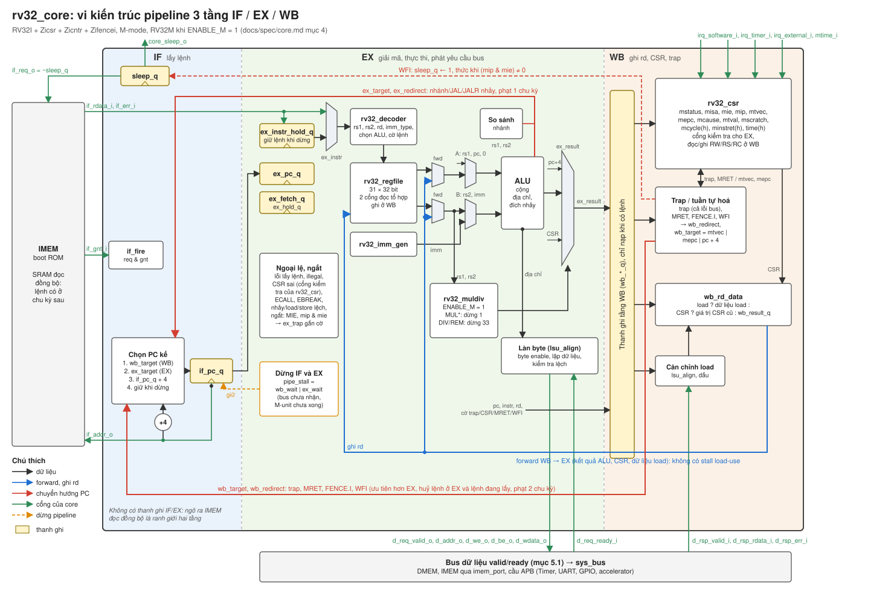

# Đặc tả core RV32I (`rv32_core`)

Chép từ đặc tả riêng của phần core (mục 4, 5.1 và 10), giữ nguyên số mục để `docs/core_decisions.md` và comment trong code trỏ tới được. Chỉ đổi đường dẫn theo cấu trúc repo này và cách viết câu.

Trạng thái: P7 xong (pipeline 3 tầng, CSR, trap, ngắt, MRET, FENCE.I, WFI ngủ, RV32M khi `ENABLE_M=1`).

Lệnh chạy: `make lint-core`, `make unit-core`, `make fw-core`, `make isa-core` (xem mục 10.4).

## 4. Core `rv32_core`

### 4.1 ISA

- RV32I + Zicsr + Zicntr + Zifencei, chỉ machine mode. RV32M khi `ENABLE_M=1`.
- FENCE thực thi như NOP. WFI cho core ngủ thật khi `ENABLE_WFI_SLEEP=1` (mục 4.11), thực thi như NOP khi bằng 0 (đặc tả cho phép cả hai).
- Load/store/nhảy lệch địa chỉ gây ngoại lệ, không xử lý bằng phần cứng (đặc tả cho phép).

### 4.2 Pipeline 3 tầng IF / EX / WB

| Tầng | Việc |
| --- | --- |
| IF | Thanh ghi `if_pc_q` là địa chỉ đưa vào IMEM (xuất phát từ flop nên đường địa chỉ IMEM ngắn), chọn PC kế tiếp |
| EX | Nhận lệnh thẳng từ ngõ ra IMEM (đọc đồng bộ), giải mã, sinh immediate, đọc register file, forward, ALU, so sánh nhánh, tính đích, tính địa chỉ load/store và kiểm tra lệch, phát yêu cầu bus dữ liệu (store ghi khi yêu cầu được nhận), M-unit |
| WB | Nhận dữ liệu đọc từ bus, căn chỉnh byte/half và mở rộng dấu, ghi register file, thực thi CSR, xử lý trap/MRET/FENCE.I, tăng minstret |

#### Sơ đồ vi kiến trúc

Hình sinh từ `docs/figures/core_microarch.py`. Muốn sửa thì đổi toạ độ trong script rồi chạy lại.

- **Datapath (đen):** `if_pc_q` đưa thẳng ra `if_addr_o`. Lệnh từ IMEM vào EX (hoặc từ `ex_instr_hold_q` khi dừng), qua decoder, regfile, mux forward, ALU. `ex_result` (kết quả ALU, PC+4, toán hạng CSR hoặc kết quả `rv32_muldiv`) vào thanh ghi tầng WB.
- **Forward (xanh dương):** `wb_rd_data` (kết quả ALU, giá trị CSR cũ, dữ liệu load đã căn chỉnh) quay về mux forward của rs1, rs2 và cổng ghi regfile trong cùng chu kỳ. Nhờ vậy không có stall load-use (mục 4.5).
- **Chuyển hướng PC (đỏ):** EX gửi `ex_target` khi nhánh/JAL/JALR nhảy, phạt 1 chu kỳ. WB gửi `wb_target` (mtvec, mepc hoặc PC+4) khi trap, MRET, FENCE.I, WFI. Đường từ WB ưu tiên hơn, huỷ lệnh ở EX và lệnh đang lấy, phạt 2 chu kỳ. WFI đặt `sleep_q`, core thức khi `(mip & mie) != 0` (mục 4.4, 4.11).
- **CSR và trap:** `rv32_csr` nằm ở WB. EX dùng cổng kiểm tra địa chỉ CSR, ngoại lệ và ngắt được gắn cờ ở EX, trap thực hiện ở WB (mục 4.7, 4.8).
- **Cổng của core (xanh lá):** cổng lệnh `if_*` tới IMEM/boot ROM, bus dữ liệu valid/ready `d_req_*`, `d_rsp_*` (mục 5.1), cổng ngắt, `mtime_i`, `core_sleep_o`.
- **Dừng (cam):** `pipe_stall = wb_wait | ex_wait` giữ IF và EX khi bus chậm hoặc M-unit chưa xong.

### 4.3 Timing lấy lệnh với SRAM đọc đồng bộ

- Chu kỳ t: IMEM nhận địa chỉ `if_pc_q`. Chu kỳ t+1: lệnh ở ngõ ra IMEM, nằm ở EX với `ex_pc_q = if_pc_q` cũ.
- Bình thường `if_pc_d = if_pc_q + 4`.
- Nhánh/JAL/JALR nhảy (quyết định ở EX): `if_pc_d = đích`, lệnh đang được lấy (PC+4) bị huỷ khi tới EX → phạt đúng 1 chu kỳ. Quyết định nhảy đi vào flop `if_pc_q`, không đi tổ hợp vào chân địa chỉ IMEM.
- Khi EX dừng (stall): chốt lệnh hiện tại vào thanh ghi giữ `ex_instr_hold_q` ở chu kỳ đầu tiên của stall, EX dùng thanh ghi giữ cho đến khi hết stall. `if_pc_q` giữ nguyên.
- IMEM đang bị bus dữ liệu dùng (`if_gnt_i=0`): chu kỳ sau EX nhận bubble, `if_pc_q` phát lại cùng địa chỉ.
- Lỗi lấy lệnh (`if_err_i`, địa chỉ ngoài IMEM/boot ROM): lệnh mang ngoại lệ instruction access fault.

### 4.4 Chuyển hướng PC (ưu tiên giảm dần)

1. Từ WB: trap, MRET, FENCE.I → huỷ lệnh ở EX (kể cả yêu cầu bus của nó trong cùng chu kỳ), PC ← đích.
2. Từ EX: branch/JAL/JALR nhảy → huỷ lệnh đang lấy. Mặc định đoán không nhảy.

### 4.5 Hazard và forwarding

- Forward WB → EX cho mọi kết quả ghi rd, gồm kết quả ALU, giá trị CSR đọc và dữ liệu load lấy thẳng từ ngõ ra bus sau khi căn chỉnh. Vì vậy không có stall load-use.
- Register file ghi ở WB. EX đọc tổ hợp và forward ưu tiên hơn register file.
- Bus chậm: yêu cầu ở EX chưa được nhận (`ready=0`), hoặc WB chờ `rsp_valid` → dừng IF và EX. WB giữ lệnh đến khi có phản hồi.
- Đường găng dự kiến (theo dõi khi quét tần số):
  1. DMEM clk→Q → căn chỉnh load → mux forward → bộ cộng địa chỉ → chân địa chỉ DMEM (setup).
  2. IMEM clk→Q → giải mã/đọc register file → mux forward → so sánh nhánh → `if_pc_q`.

### 4.6 Load/store

- Byte enable và dịch dữ liệu ghi vào đúng làn byte theo `addr[1:0]`.
- Căn chỉnh dữ liệu đọc, mở rộng dấu (LB, LH) hoặc 0 (LBU, LHU) ở WB.
- Lệch địa chỉ (LH/LHU/SH với addr[0]=1, LW/SW với addr[1:0]≠0): ngoại lệ, không phát yêu cầu bus.

### 4.7 CSR (M-mode, có ngay từ base)

| CSR | Hành vi |
| --- | --- |
| mstatus | MIE (3), MPIE (7) đọc ghi. MPP (12:11) cố định 11. Bit khác đọc 0 |
| misa | Chỉ đọc giá trị `0x40000100`, cộng `0x1000` khi ENABLE_M. Ghi bị bỏ qua (WARL) |
| mie | MSIE (3), MTIE (7), MEIE (11) đọc ghi |
| mip | MSIP (3), MTIP (7), MEIP (11) chỉ đọc, lấy từ cổng ngắt |
| mtvec | Chế độ direct, bit 1:0 luôn đọc 0 |
| mepc | Bit 1:0 luôn 0 |
| mcause, mtval, mscratch | Đọc ghi |
| mcycle(h), minstret(h) | 64 bit. mcycle tăng mỗi chu kỳ. minstret tăng khi một lệnh hoàn thành ở WB (lệnh bị trap không tính) |
| cycle(h), time(h), instret(h) | Chỉ đọc. time lấy từ `mtime_i` |
| mhartid, mvendorid, marchid, mimpid | Chỉ đọc, giá trị 0 |

- CSR không tồn tại, hoặc ghi vào CSR chỉ đọc (addr[11:10]=11): illegal instruction. CSRRS/CSRRC với rs1=x0, và CSRRSI/CSRRCI với uimm=0, không tính là ghi.
- Lệnh CSR thực thi ở WB. Lệnh kế tiếp ở EX nhận giá trị qua forward WB → EX.

### 4.8 Trap và ngắt

- Ngoại lệ được gắn cờ khi phát hiện (EX hoặc lỗi bus ở WB) và xử lý tại WB: ghi mepc, mcause, mtval, rồi MPIE ← MIE, MIE ← 0, PC ← mtvec, huỷ lệnh ở EX. MRET: MIE ← MPIE, MPIE ← 1, PC ← mepc.
- mcause: 0 instruction misaligned (đích nhảy có bit 1 = 1), 1 instruction access fault, 2 illegal, 3 breakpoint, 4 load misaligned, 5 load access fault, 6 store misaligned, 7 store access fault, 11 ECALL.
- mtval: illegal → mã lệnh, lệch địa chỉ/access fault → địa chỉ, breakpoint (EBREAK) → PC của lệnh EBREAK, còn lại 0 (D-035).
- Ngoại lệ chính xác: trong chu kỳ WB chuyển hướng, chặn yêu cầu bus của lệnh ở EX (tín hiệu valid của bus phụ thuộc tổ hợp vào việc WB có chuyển hướng hay không).
- Ngắt: MEI (11) > MSI (3) > MTI (7), mcause bit 31 = 1. Khi `MIE=1` và có ngắt chờ được bật, lệnh hợp lệ ở EX được đánh dấu "bị ngắt": không thực thi, không phát yêu cầu bus, tới WB thì nhận trap với mepc = PC của nó.
- Khi WB đang ghi mstatus hoặc mie, kiểm tra ngắt ở EX dùng giá trị MIE và mie sau lần ghi đó (forward 4 bit bật ngắt, D-038). Vì vậy bật hay tắt ngắt đều có hiệu lực ngay từ lệnh kế tiếp: sau `csrci mstatus, MIE` lệnh kế không bị ngắt, sau `csrsi mstatus, MIE` lệnh kế bị ngắt nếu có ngắt chờ. Không nhận ngắt khi WB đang chuyển hướng (lệnh ở EX bị huỷ).
- Lỗi bus (`rsp_err`) cho load/store → access fault tại WB.

### 4.9 RV32M (`ENABLE_M=1`)

- MUL, MULH, MULHSU, MULHU: tách 2 chu kỳ bằng thanh ghi trung gian trong RTL (EX dừng 1 chu kỳ), không dùng multicycle path trong SDC.
- DIV, DIVU, REM, REMU: bộ chia lặp 1 bit/chu kỳ (~33 chu kỳ), EX dừng đến khi xong.
- Trường hợp đặc biệt theo đặc tả: chia cho 0 (DIV/DIVU → tất cả bit 1, REM/REMU → số bị chia), tràn −2^31 / −1 (DIV → −2^31, REM → 0).

### 4.10 Cổng của core

| Cổng | Hướng | Ý nghĩa |
| --- | --- | --- |
| clk, rst_n | in | Clock, reset |
| if_req_o, if_addr_o[31:0] | out | Yêu cầu đọc lệnh |
| if_gnt_i | in | Yêu cầu lệnh được nhận trong chu kỳ này |
| if_rdata_i[31:0], if_err_i | in | Lệnh và lỗi, chu kỳ sau |
| d_req_valid_o, d_req_ready_i, d_addr_o[31:0], d_we_o, d_be_o[3:0], d_wdata_o[31:0] | out/in | Kênh yêu cầu bus dữ liệu (mục 5.1) |
| d_rsp_valid_i, d_rsp_rdata_i[31:0], d_rsp_err_i | in | Kênh phản hồi |
| irq_software_i, irq_timer_i, irq_external_i | in | Nguồn ngắt mức (thêm ở P4) |
| mtime_i[63:0] | in | Cho CSR time/timeh (thêm ở P4) |
| core_sleep_o | out | Core đang ngủ do WFI, cho SoC tắt enable IMEM, dùng trong báo cáo power (thêm ở P4) |
| Tham số: ENABLE_M, ENABLE_WFI_SLEEP, RESET_PC (mặc định 0x0001_0000, boot ROM) | | |

### 4.11 WFI ngủ (`ENABLE_WFI_SLEEP=1`)

- WFI được xử lý ở WB như lệnh tuần tự hoá: huỷ lệnh ở EX, đặt `sleep_q=1`, PC kế tiếp = PC(WFI)+4.
- Khi ngủ: `if_req_o=0` (IMEM không đọc), mọi thanh ghi pipeline, register file và M-unit giữ nguyên nhờ tắt enable, để Genus gate clock. mcycle và mtime vẫn chạy.
- Thức dậy khi `(mip & mie) != 0`, không phụ thuộc mstatus.MIE (đúng đặc tả). Nếu MIE=1, ngắt được nhận ở lệnh kế tiếp với mepc = PC(WFI)+4. Nếu MIE=0, chạy tiếp lệnh sau WFI.
- Nếu `(mip & mie) != 0` ngay lúc WFI ở WB thì core không ngủ, chỉ chuyển hướng tới PC+4 (D-038). Nếu MIE=1 và ngắt đã chờ khi WFI còn ở EX thì chính WFI bị ngắt, mepc = PC(WFI).
- Test `fw/tests/asm/wfi_pending.S`: ngắt chờ sẵn rồi mới WFI với MIE=0 (WFI như NOP, 0 chu kỳ ngủ) và với `csrsi mstatus` ngay trước WFI (trap ở WFI), cửa sổ `csrs`/`csrc mstatus`, vòng chờ không race, `csrs mie` khi MIE=1. Chạy cả `ENABLE_WFI_SLEEP=0` và 1.
- Test: firmware đo số chu kỳ ngủ. Báo cáo so sánh công suất lúc chờ ngắt bằng vòng lặp polling và bằng WFI (cùng testcase, có VCD).

Trace cho testbench (PC, mã lệnh, rd, dữ liệu ghi tại WB) lấy bằng tham chiếu phân cấp, không thêm cổng.

## 5. Bus

### 5.1 Bus hệ thống valid/ready (core ↔ bộ nhớ, cầu APB)

| Kênh | Tín hiệu | Hướng |
| --- | --- | --- |
| Yêu cầu | req_valid, req_ready, addr[31:0], we, be[3:0], wdata[31:0] | valid và thông tin: master → slave, ready: slave → master |
| Phản hồi | rsp_valid, rdata[31:0], err | slave → master (master luôn nhận) |

Luật:

1. Yêu cầu được nhận ở chu kỳ có `req_valid && req_ready`. `req_ready=0` là wait state, khi đó master giữ nguyên mọi tín hiệu yêu cầu.
2. Mỗi yêu cầu được nhận (đọc hoặc ghi) có đúng một `rsp_valid`, sớm nhất ở chu kỳ sau, theo thứ tự.
3. Tối đa 1 yêu cầu đang chờ. Master được phát yêu cầu mới ngay trong chu kỳ nhận `rsp_valid` của yêu cầu trước (cho phép load liên tiếp mỗi chu kỳ).
4. `err` chỉ có nghĩa khi `rsp_valid=1`. Khi `err=1` thì `rdata=0`.
5. `req_valid` không phụ thuộc tổ hợp vào `req_ready`.
6. SRAM (`rtl/mem/sram_wrap.v`): đọc và SW được nhận ngay (`req_ready=1`), `rsp_valid` ở chu kỳ ngay sau (khớp đọc đồng bộ). SB/SH có 1 wait state (`req_ready=0`) do macro không ghi theo byte nên phải đọc-sửa-ghi.
7. Vẽ timing diagram cho đọc SRAM, ghi SRAM, đọc qua APB có wait state, và lỗi vào `docs/timing_bus.md` (dùng trong báo cáo).

`sys_bus`: tham số `N_MASTER` (mặc định 1, phải chạy đúng với 2 khi có DMA, trọng tài round-robin), giải mã địa chỉ theo bản đồ địa chỉ của SoC, slave lỗi trả `err` cho địa chỉ không ánh xạ hoặc tính năng đang tắt, định tuyến phản hồi về đúng master.

## 10. Phần mềm và kiểm chứng

### 10.1 Toolchain

- `riscv64-unknown-elf-gcc` hoặc `riscv-none-elf-gcc` (Makefile tự dò), `-march=rv32i_zicsr_zifencei` (thêm `m` khi ENABLE_M), `-mabi=ilp32`.
- `fw/common/link.ld`: `.text` ở IMEM 0x0000_0000. `.rodata`, `.data`, `.bss`, `.tohost` và stack ở DMEM.
- `scripts/elf2hex.py`: tách ELF thành `imem.hex`, `dmem.hex` (word, địa chỉ tương đối) và in địa chỉ symbol `tohost`. Base và kích thước vùng lấy từ `tb/core/core_tb_map.vh` (IMEM 0x0000_0000, DMEM 0x1000_0000, mỗi vùng 16 KB, UART DATA 0x2000_1000). File này phải khớp bản đồ địa chỉ của SoC.

### 10.2 Kết thúc mô phỏng (dùng chung cho riscv-tests và firmware)

- Testbench theo dõi lệnh ghi vào `tohost` (`+tohost=<hex>`): 1 = PASS, giá trị lẻ khác 1 = FAIL, mã lỗi = giá trị >> 1.
- Testbench bắt lệnh ghi vào UART DATA và in ký tự ngay (không chờ mô phỏng baud).
- Timeout `+timeout=<chu kỳ>`. Khi kết thúc in số chu kỳ, số lệnh, CPI.
- `+trace`: ghi vết từng lệnh hoàn thành (PC, mã lệnh, rd, giá trị) theo định dạng gần commit log của Spike. Lệnh nhận trap in một dòng `trap` với mcause, mepc, mtval.
- Trap khi `mtvec` còn bằng 0 (chưa cài trình xử lý) là FAIL.
- Khối điều khiển riêng của tb ở `CORE_TB_CTRL_BASE` (0x2FFF_0000): đặt mức 3 đường ngắt sau N chu kỳ, đọc số chu kỳ ngủ, đọc cấu hình. Macro `TB_*` trong `fw/tests/asm/test_macros.h`. `mtime_i` tăng mỗi chu kỳ.

### 10.3 Bộ test ISA

- riscv-tests env `p` (submodule `fw/riscv-tests`, ghim commit) với `fw/common/link_isa.ld` riêng: mọi section ở IMEM vì `fence_i` chạy lệnh trong `.data`. Core chỉ M-mode, MPP cố định 11, CSR không hỗ trợ trap đúng chuẩn, nên env p chạy được.
- Mục tiêu: 100% `rv32ui-p-*` (kể cả fence_i), 100% `rv32mi-p-*` áp dụng được cho core M-mode không có debug trigger, 100% `rv32um-p-*` khi ENABLE_M=1.
- riscv-arch-test (qua RISCOF, so với Spike) làm bằng chứng tuân thủ chính thức trong báo cáo.
- Kết quả từng test ghi vào `docs/riscv-tests-status.md`, test bị loại có lý do.

### 10.4 Makefile

Target của core trong repo này có tiền tố riêng, chạy ở nhà:

| Target | Việc |
| --- | --- |
| `lint-core` | `verilator --lint-only -Wall` cho từng module trong `rtl/core` (`rv32_core` với 4 tổ hợp ENABLE_M × ENABLE_WFI_SLEEP, `rv32_decoder` và `rv32_csr` với ENABLE_M=0 và 1), 0 warning (waiver duy nhất là `unused_ok` của regfile, có comment lý do) |
| `unit-core` | Mọi `tb/unit/tb_rv32_*.v`, `TB=<tên>` để chạy một bài, `PLUSARGS="+seed=7 +n=1000"` để đổi seed |
| `fw-core` | Biên dịch `fw/tests/asm/*.S` và chạy trên `tb/core/tb_core.v` với 4 cấu hình `M<ENABLE_M>W<ENABLE_WFI_SLEEP>`, mỗi bài 4 chế độ (đúng timing không stall và 3 bộ stall bus ngẫu nhiên). `T=<tên>` để chạy một bài, `PLUSARGS=+trace` để in vết |
| `isa-core` | riscv-tests rv32ui, rv32mi (và rv32um khi ENABLE_M=1) với cấu hình M0W0 và M1W1, 4 chế độ. `T=rv32ui-p-add` để chạy một bài. Test bị loại nằm trong `CORE_ISA_SKIP` |
| `clean-core` | Xoá `tb/core/out` và `tb/unit/out/core` |

`fw-core` và `isa-core` chạy song song `CORE_JOBS` tiến trình (mặc định bằng số nhân CPU) qua `scripts/core_run.sh`, tổng kết ghi ở `tb/core/out/<target>.summary`. Bảng kết quả riscv-tests: `python3 scripts/isa_status.py`.

Dự kiến thêm: `regress-core` (lint + unit + isa + fw).
